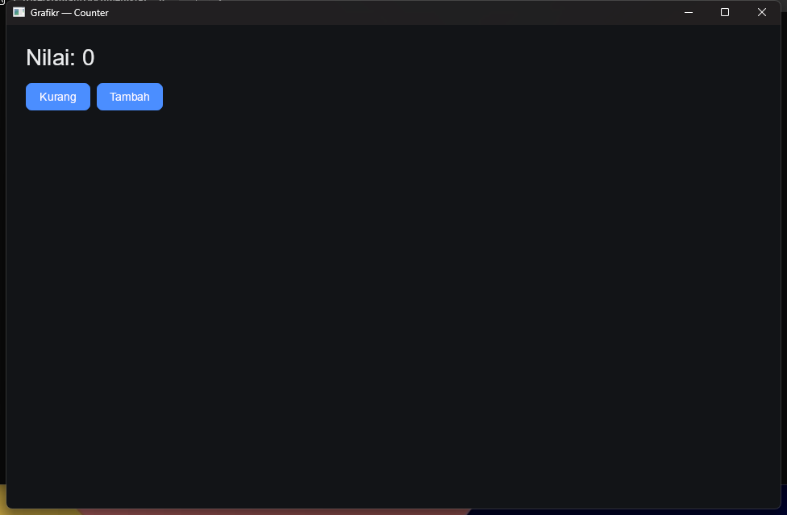
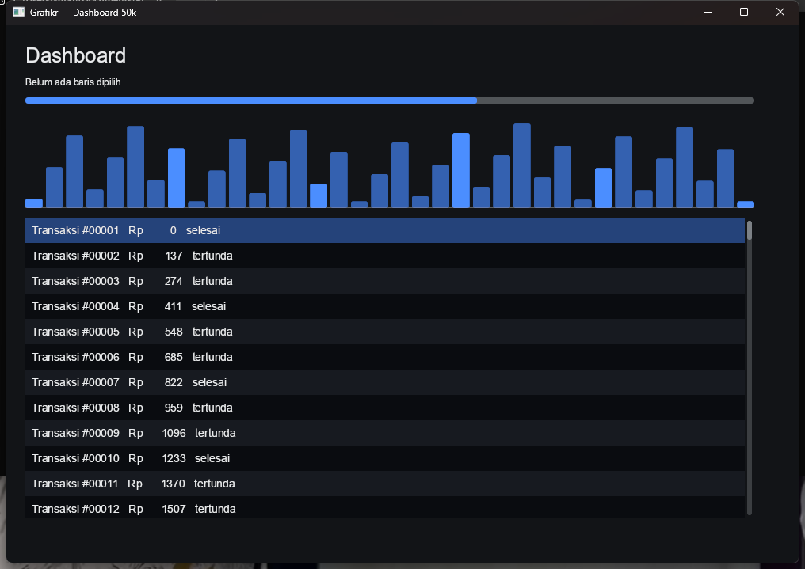

# Grafikr

A native desktop UI framework for Rust with a retained widget tree, reactive
state, its own GPU renderer (wgpu), and Unicode text through Parley. No WebView,
no WinUI/Cocoa/GTK wrapper.

Status: **1.0.0** on Windows/D3D12. Wayland/X11/macOS QA and the GPU vendor
matrix are still outstanding. The public API follows SemVer.





More examples: [settings](docs/settings.png), [dialog](docs/dialog.png),
[tabs](docs/tabs.png), [menu](docs/menu.png), [image](docs/image.png),
[spinner](docs/spinner.png), [combo](docs/combo.png),
[datagrid](docs/datagrid.png), [tree](docs/tree.png),
[tooltip](docs/tooltip.png).

## Running

```bash
cargo run                    # counter
cargo run -p form            # form + text field
cargo run -p dashboard       # 50,000 virtual rows + canvas
cargo run -p settings        # MVP controls + password + scroll view
cargo run -p dialog          # modal + focus trap + Escape
cargo run -p tabs-demo       # tabs with pane visibility
cargo run -p menu-demo       # popup/menu + click outside
cargo run -p image-demo      # RGBA image + texture cache
cargo run -p spinner-demo    # spinner + animation scheduler
cargo run -p combo-demo      # ComboBox + dropdown
cargo run -p datagrid-demo   # DataGrid with 50k rows
cargo run -p tree-demo       # TreeView expand/collapse
cargo run -p tooltip-demo    # tooltip hover delay
cargo run -p multi-window    # two windows
cargo test --workspace
cargo run -p grafikr-bench --release
```

Requires Rust 1.88+ (edition 2024). The GPU is accessed through DX12/Vulkan/
Metal/GLES.

## What's included

| Area | Status |
| --- | --- |
| Native window, DPI, resize, surface + device recovery | winit 0.30 + wgpu 30 |
| Rect, rounded rect, border, clipping | SDF quad pipeline |
| Shadow | stacked SDF quads (modal/popup/dropdown/tooltip) |
| Transform | translate + uniform scale, inverse hit-testing |
| Unicode text, shaping, font fallback, BiDi | Parley 0.12 |
| Glyph atlas | bounded 1024x1024 cache, automatic reset |
| Image | raw RGBA, per-handle texture upload, bounded cache |
| Retained tree + stable `NodeId` | generational arena |
| Layout | Taffy 0.15 (flex row/column, grid, gap, padding) |
| Reactive state | `Signal<T>` + `bind`, dependency tracking |
| Dirty flags | STYLE / LAYOUT / PAINT / ACCESSIBILITY |
| Event capture/bubble, hover, pressed | pointer + keyboard |
| Overlay | dynamic visibility, absolute inset, z-order, focus scope |
| Focus + Tab navigation | depth-first order, modal trap |
| Theme | dark/light tokens, state styles |
| Button | mouse, keyboard, focus ring, icon/secondary variants, AccessKit |
| TextField | selection, clipboard, IME, cursor, multiline, password, AccessKit |
| Checkbox / radio / switch / slider | signal binding, keyboard, AccessKit |
| Progress / spinner | AccessKit, frame scheduler while active |
| ScrollView | wheel, keyboard, scrollbar drag, clipping |
| VirtualList | 50,000 rows, only visible rows are drawn/shaped |
| Canvas | custom paint using the same display list |
| Grid / Stack | `1fr` grid, layered children |
| Modal/dialog | backdrop, card, focus trap, Escape, focus restore |
| Tabs | header, underline, pane visibility, Left/Right keyboard |
| Popup/menu | layer, click-outside, Escape, focus trap |
| ComboBox | dropdown, item selection, keyboard, focus restore |
| Tooltip | hover delay + animation scheduler |
| DataGrid | 50,000 virtual rows, header, columns, row selection |
| TreeView | expand/collapse, indent, keyboard, virtual rows |
| Multi-window | view tree, GPU context, AccessKit per window |
| Accessibility | AccessKit tree + Click/Focus/SetValue |
| Animation | `Transition` + `Easing`, frame scheduler, reduced motion |
| Benchmark | signal, shaping, layout, remount, 50k list scroll |
| Golden image | headless renderer + cross-driver tolerance |
| Diagnostics | `UiStats`, `RendererStats` |

The render object is a `DisplayList` containing quads, glyph runs, images, and
shadows. The renderer never sees the widget tree.

## Not yet available

- Offscreen layers and rotation. Transform currently supports translation and
  uniform scale only.
- Per-subtree layout. Taffy skips clean branches, but the call still starts at
  the root (about 0.55 ms for 1,000 text nodes).
- Subpixel glyph positioning, cursor blink, undo/redo.
- VirtualList/DataGrid/TreeView draw rows with custom paint instead of
  recycling row widgets.
- Golden images are only verified on Windows/D3D12 so far; no GPU vendor matrix
  yet.
- Rich clipboard (HTML/image) and drag-and-drop.
- Multi-property keyframes; `Transition` currently animates a single `f32`.

The full phase list is in [`docs/ROADMAP.md`](docs/ROADMAP.md). See the
[documentation index](docs/README.md) for the tutorial, status, migration notes,
architecture decisions, and the release checklist.

## API

```rust
use grafikr::{App, Signal, Theme, View, bind, button, column, row, text};

fn counter() -> impl View {
    let count = Signal::new(0);
    let value = count.clone();
    let less = count.clone();
    let more = count.clone();

    column((
        text(bind(move || format!("Value: {}", value.get()))).size(28.0),
        row((
            button("Less").on_click(move |_| less.update(|n| *n -= 1)),
            button("More").on_click(move |_| more.update(|n| *n += 1)),
        ))
        .gap(8.0),
    ))
    .padding(24.0)
    .gap(16.0)
}

fn main() {
    App::new(counter)
        .theme(Theme::dark())
        .run()
        .unwrap();
}
```

Custom widget: implement `Widget` (`measure`, `paint`, optional `event`,
`focusable`, `cursor`, `accepts_text_input`, `accessibility`) and wrap it in a
`View` that calls `cx.add_node` + `cx.set_widget`. Add a one-line
`impl IntoViews` so it can be used as a child container.

## Workspace

```
crates/grafikr-core      state, tree, scroll, layout, text, event, a11y
crates/grafikr-render    display list -> wgpu, glyph atlas, image, shadow
crates/grafikr-widgets   text, button, field, controls, lists, overlays, canvas
crates/grafikr-shell     winit event loop, windows, surfaces, clipboard, AccessKit
crates/grafikr           public facade
examples/counter         reactive counter
examples/form            text field, binding, and buttons
examples/dashboard       virtual list with 50,000 rows + canvas chart
examples/settings        MVP controls + password + scroll view
examples/dialog          modal, focus trap, Escape
examples/tabs            tabs + pane visibility
examples/menu            popup/menu
examples/image           RGBA image
examples/spinner         spinner + animation scheduler
examples/combo           ComboBox dropdown
examples/datagrid        DataGrid with 50k rows
examples/tree            TreeView expand/collapse
examples/tooltip         tooltip hover delay
examples/windows         two windows
benchmarks
docs/adr
docs/tutorial.md
docs/MIGRATION.md
CHANGELOG.md
```

## Performance notes

- Idle does not render: redraw is requested only when a dirty flag is set.
  Measured on the counter example: 0 seconds of CPU over 4 seconds idle.
  While a spinner is active, the scheduler requests frames at roughly 60 fps
  (about 0.06 seconds of CPU per second on the development machine); when the
  spinner disappears the loop returns to idle.
- One label changes: the tree is not rebuilt; only that node is re-shaped and
  Taffy recomputes layout (not subtree-only yet).
- Vertex buffers are reused; per-frame display-list allocation remains.
- Glyph and text-layout caches are bounded and reset when full.
- Layout and text positions use DIP; glyphs are rasterized at physical size
  (`font_size x scale`) and origins are rounded to physical pixels.
- Release benchmark on the development machine (Windows, D3D12):
  signal 0.01 us; shaping 6.0 us; cache hit 0.03 us; layout of 1,000 text nodes
  0.53 ms; update one label 0.61 ms; remount 1,000 nodes 11.5 ms;
  scroll 50k virtual rows 8.8 us.
- `Ui::stats()` and `Renderer::stats()` expose node, display-item, glyph-atlas,
  image-cache, vertex, and batch counters for profiling.

Absolute numbers are not a promise; measure again on reference hardware.

## License

Grafikr is licensed under the GNU Affero General Public License v3.0
(`AGPL-3.0-only`). See [`LICENSE`](LICENSE).
